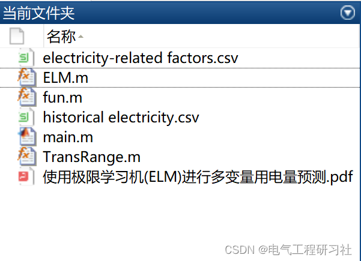
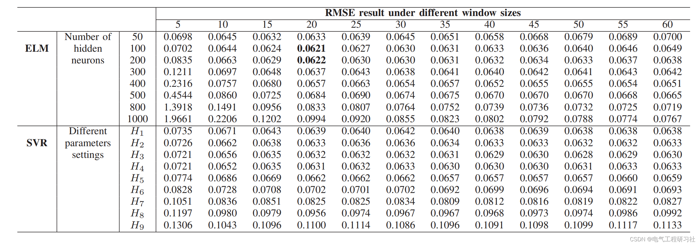

# Multivariate Electricity Consumption Prediction Based on Extremum Learning Machine (ELM) in Matlab

​  
📋📋📋This article is organized as follows: ⛳️⛳️⛳️​Directory 1: Overview 2 Matlab Code Implementation 3 Final Thoughts Furthermore, the potential of enhancing the prediction accuracy by utilizing auxiliary information such as electricity-related factors and environmental factors was investigated using ELM. Furthermore, we utilize the most suitable ELM structure to propose a combined optimization problem to find the optimal subset of auxiliary factors and their corresponding optimal window sizes. We also introduce a discrete dynamic multi-group particle swarm optimization (DDMS-PSO) to solve this problem. Experimental studies on real-world building datasets have shown that factors related to electricity can enhance accuracy, while environmental factors can further improve it. Through the use of DDMSPSO, we found a subset of electrically related and environmental factors with their respective window sizes and number of hidden neurons in ELM to achieve the best prediction accuracy.
2. Matlab code implementation of the article includes Matlab code, data, and article explanation:
Editor
Editor 3: Final Note - The references to theoretical concepts in this article are from online sources. If any infringement is found, please contact the blogger for removal.
​  

## Images

<!-- PAYMENT_BLOCK -->

## Get this dataset

- Payment link (Stripe): [Buy now](https://buy.stripe.com/3cs8yP7sY87d0vu9AB)
- Payment QR code: 

<!-- /PAYMENT_BLOCK -->
